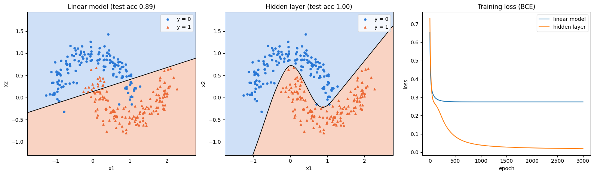

# Inside the Backward Pass

A small neural network library built **from scratch with NumPy only**. It computes its own gradients (backpropagation) and uses them to solve a problem a linear model cannot: the **two moons** dataset.

**Rules followed:** NumPy and Matplotlib only. No PyTorch, TensorFlow or autograd libraries.

---

## What is in this repository

| File | Description |
|---|---|
| `backward_pass_capstone.ipynb` | The full project: engine, hand-trace check, training and plots |
| `results.png` | Decision boundaries and loss curves (linear model vs hidden-layer network) |
| `paper_trace_1.jpg` | Paper Trace |
| `paper_trace_1.jpg` | Paper Trace |
| `Inside the Backward Pass Report` | Report |
| `README.md` | Readme |

---

## How to run

**In Google Colab:** upload the notebook, then choose **Runtime → Run all**.

**On your computer:**
```bash
pip install numpy matplotlib jupyter
jupyter notebook backward_pass_capstone.ipynb
```
Then run all cells from top to bottom. It takes a few seconds.

---

## The dataset: two moons

300 points with two coordinates `(x1, x2)`, generated with NumPy (no scikit-learn). The label `y` is 0 for the upper moon and 1 for the lower moon. The moons interlock, so **no straight line can separate them**. This is why a hidden layer is needed.

- `X` has shape `(300, 2)` and `y` has shape `(300, 1)`.
- 225 points are used for training and 75 for testing.
- A fixed seed (`42`) makes the results reproducible.

---

## The engine

Every layer is a class with `forward(x)` and `backward(upstream_grad)`.

| Class | Forward | Backward (what it returns) |
|---|---|---|
| `Linear` | `z = x Wᵀ + b` | `dW = upstreamᵀ · x`, `db = sum(upstream)`, returns `upstream · W` |
| `Sigmoid` | `1 / (1 + e^(−z))` | `upstream · s(1 − s)` |
| `ReLU` | `max(0, z)` | `upstream · (z > 0)` |
| `Tanh` | `tanh(z)` | `upstream · (1 − tanh²)` |
| `MSELoss` | `1/(2m) · Σ (ŷ − y)²` | `(ŷ − y) / m` |
| `BCELoss` | `−1/m · Σ [y ln ŷ + (1−y) ln(1−ŷ)]` | `(ŷ − y) / (ŷ(1 − ŷ)) / m` |
| `Network` | calls layers **in order** | calls layers **in reverse order** |

Each layer saves what its `backward` needs during `forward` (for example `Linear` saves its input `x`). `Network.step(lr)` then updates the weights with gradient descent: `W = W − lr · dW`.

### Minimal example
```python
net = Network([Linear(2, 8), Tanh(), Linear(8, 1), Sigmoid()])
loss_fn = BCELoss()

for epoch in range(3000):
    y_hat = net.forward(X)                   # forward pass
    loss = loss_fn.forward(y_hat, y)         # loss
    net.backward(loss_fn.backward())         # backward pass (fills dW, db)
    net.step(lr=0.5)                         # gradient descent update
```

---

## Phase 1: hand trace vs code

The fixed network has 2 inputs, 2 hidden neurons (sigmoid) and 1 output neuron (sigmoid), with loss `L = ½(ŷ − y)²` for one data point.

```
x1, x2 → z1, z2 → h1, h2 → z3 → ŷ → loss
```

The code output matches the hand calculation (all values rounded to 6 decimals):

| Quantity | Value |
|---|---|
| `z1, z2` | 0.3, 0.6 |
| `h1, h2` | 0.574443, 0.645656 |
| `z3` | 0.896625 |
| `ŷ` | 0.710255 |
| loss | 0.041976 |
| `dL/dŷ` | −0.289745 |
| `dL/dz3` | −0.059627 |
| `dL/dW31, dL/dW32` | −0.034252, −0.038499 |
| `dL/dz1, dL/dz2` | −0.008746, −0.009549 |
| `dL/dW11, dL/dW12` | −0.008746, −0.004373 |
| `dL/dW21, dL/dW22` | −0.009549, −0.004775 |

The full step-by-step hand calculation is in the paper trace.

---

## Results: linear model vs hidden layer

Both models are trained with `BCELoss`, learning rate 0.5, 3000 epochs.

| Model | Train accuracy | Test accuracy |
|---|---|---|
| Linear model (`Linear` + `Sigmoid`) | 87.1% | 89.3% |
| Network 2 → 8 (Tanh) → 1 (Sigmoid) | 98.7% | 100% |



- The linear model can only draw a straight line, so it stops improving at about 87–89%.
- The hidden layer learns a curved boundary that follows the two moons.
- The test set has only 75 points, so its accuracy is a rough estimate. The training accuracy is the more stable number.

---

## How the backward pass works (short version)

1. **Forward:** the input goes through the layers in order. Each layer saves what it needs.
2. **Loss:** compare the prediction `ŷ` with the label `y`.
3. **Backward:** start with `dL/dŷ` and move through the layers in **reverse order**. Each layer multiplies the gradient it receives (`upstream`) by its own local derivative (the chain rule) and passes the result to the layer before it.
4. **Update:** every `Linear` layer has now stored `dW` and `db`. Gradient descent moves the weights against the gradient.

---

## Requirements

- Python 3
- NumPy
- Matplotlib


